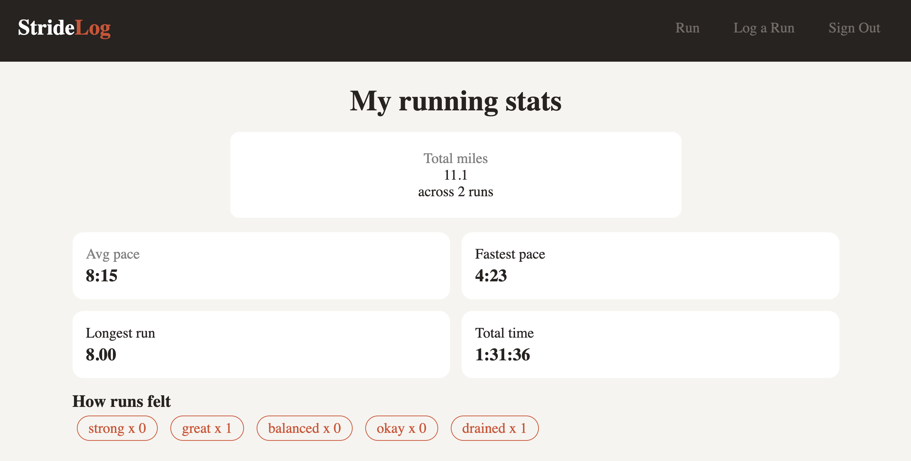

# 🏃 Run Log

Log your runs, track how they felt, and watch your progress add up.

**Live Demo:** [Live Site\]](https://run-log-ec9a.onrender.com/login)

---

## 📖 About

Run Log is a full-stack running tracker. After signing up, users log each run with its distance, time, date, and how it felt. Runs are listed newest first, and each one can be opened, edited, or deleted.

The profile page turns all of that into stats: total runs, miles, and time, average and fastest pace, longest run, and a tracker showing how often runs felt Strong, Great, Balanced, Okay, or Drained.

---

## 🛠️ Built With

Node.js · Express · MongoDB · Mongoose · EJS · Passport.js · bcrypt · express-session · connect-flash

---

## 📸 Preview



---

## 💡 What I Learned

- Building full CRUD with Express routes and Mongoose
- User signup and login with Passport.js and hashed passwords
- Calculating pace and totals from stored data
- Converting seconds into a readable `h:mm:ss` time
- Sending PUT and DELETE requests with `fetch()`

---

## 🚀 Run It Locally

```bash
git clone https://github.com/smayanja3/[repo-name].git
cd [repo-name]
npm install
```

Create a `.env` file:

```
MONGODB_URI=your-mongodb-connection-string
SESSION_SECRET=any-secret-phrase
PORT=5030
```

Then run `npm run dev` and open `http://localhost:5030`.